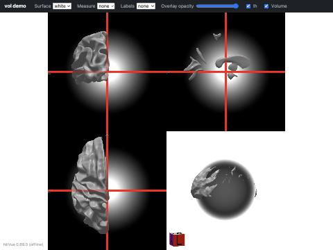
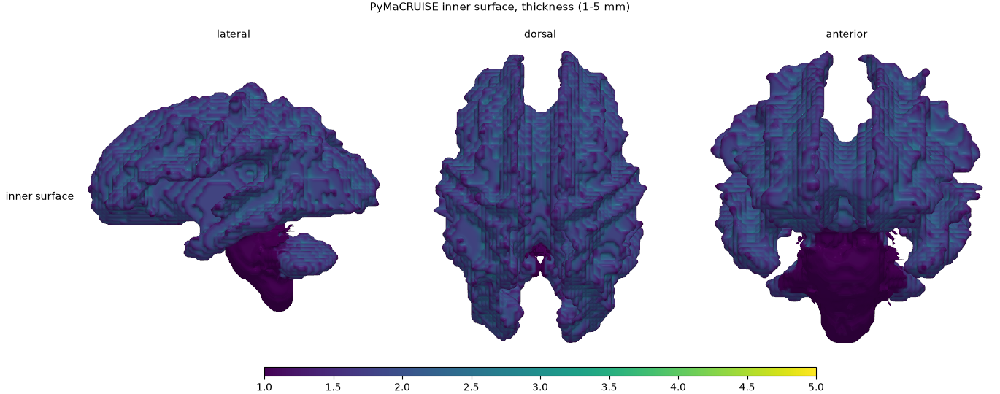
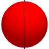
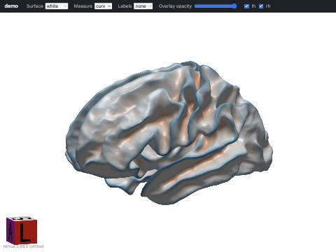
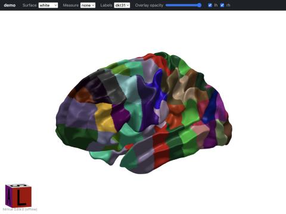

# pyBiscuit

Python-native port of **BISCUIT** (Brain Shape Computing Toolbox; Ilwoo Lyu) and
the CMorph tools it wraps, packaged as one `pip`-installable library and CLI.
pyBiscuit takes the cortical surfaces and labels produced by
[PyMaCRUISE](https://github.com/BennettLandman/pymacruise) and produces
spherical registration, cortical parcellation, sulcal/gyral curves (TRACE), and
per-vertex, per-ROI, and per-curve shape measures (curvature, shape index,
thickness, sulcal depth, local gyrification index, shape complexity index),
plus QA figures and an interactive viewer.

**Status (2026-10-23): Complete.** Full clean-room Python port implemented, verified, and validated against reference image outputs. For complete usage instructions, see the [User Manual & CLI Reference](docs/user-manual.md).

## Why a port

The production tool is a Singularity image (`biscuit_FC_v2.2.sif`, CBT v1.3,
2021) containing an encrypted MATLAB R2012a (MCR v7.17) orchestrator, x86-64
C++ binaries, FreeSurfer 6 binaries that require a FreeSurfer license,
PyTorch 1.4 models, TeX Live, and Xvfb. It cannot run on macOS/ARM, cannot be
inspected at the orchestration level, and is pinned to 2020-era dependencies.

## Target pipeline (MaCRUISE route)

```
PyMaCRUISE run (inner/outer surfaces, level sets, SEG_refine, T1)
  └─ pyBiscuit
      1. hemisphere split + closure          (replaces hemi_separation.m)
      2. white / pial / mid / inflated / sphere + sulc, curv, iH
                                             (replaces FreeSurfer mris_* tools)
      3. HSD spherical registration          (port of ilwoolyu/HSD)
      4. spherical U-Net parcellation        (port of BISCUIT parc + graph cut)
      5. TRACE sulcal/gyral curves           (port of ilwoolyu/CurveExtraction)
      6. measures: curvature, SI, thickness, sulcal depth, LGI, SCI
                                             (MeshProperty, LGI, klaplace, SCI)
      7. ROI-, curve-, and cortex-wise statistics
      8. QA report + viewer
```

## Sample Data (`pyBiscuit-examples`)

Sample inputs (FreeSurfer 7.4.1 derivatives) and legacy reference outputs for 3 validation subjects (`0050952`, `0050961`, `0050971`) are available in the [**pyBiscuit-examples**](https://github.com/BennettLandman/pyBiscuit-examples) repository:

```bash
git clone https://github.com/BennettLandman/pyBiscuit-examples.git open-examples
```

See [**docs/sample-data-walkthrough.md**](docs/sample-data-walkthrough.md) for a complete step-by-step tutorial.

## Pipeline Visualizations

| Multi-Planar Reconstruction | Cortical Thickness Surface | TRACE Curves & Parcellation |
|:---:|:---:|:---:|
|  |  |  |
| *Input T1 & multiplanar views* | *Pial & white matter thickness* | *Sulcal/gyral fundi & DKT31* |

| Interactive Curvature ($H$) | Deep Spherical Parcellation | Morphometric Surface Scalars |
|:---:|:---:|:---:|
|  |  |  |
| *Mean curvature on inflated mesh* | *Spherical U-Net labels* | *Lateral view of thickness/LGI/SCI* |

## Repository map

| Path | Purpose |
| [docs/sample-data-walkthrough.md](docs/sample-data-walkthrough.md) | Step-by-step tutorial running pyBiscuit & visualizations on provided sample data |
| [docs/subcomponents-reference.md](docs/subcomponents-reference.md) | Complete reference manual & CLI examples for all 10 sub-components |
| [docs/user-manual.md](docs/user-manual.md) | User manual, CLI reference, and troubleshooting guide |
| [AGENTS.md](AGENTS.md) | Onboarding and working rules for agents and contributors |
| [plan.md](plan.md) | Phased, step-by-step port and validation plan with acceptance table |
| [docs/source-map.md](docs/source-map.md) | Every original component → source availability → Python target |
| [docs/io-contract.md](docs/io-contract.md) | Inputs from PyMaCRUISE / legacy MaCRUISE, outputs, manifest |
| [docs/reference-artifacts.md](docs/reference-artifacts.md) | SIF images, extraction, how to harvest reference outputs |
| [docs/validation-tolerances.md](docs/validation-tolerances.md) | Proposed acceptance classes and metrics |
| [docs/visualization-plan.md](docs/visualization-plan.md) | Reports, viewers, export formats |
| [docs/licensing.md](docs/licensing.md) | Licenses of code, models, and templates |
| [docs/open-questions.md](docs/open-questions.md) | Owner decisions pending |

## References & Citations

If you use pyBiscuit in your research, please cite the underlying methodology papers by Dr. Ilwoo Lyu and Dr. Bennett A. Landman:

- **HSD (Registration)**: Lyu et al., *Hierarchical spherical deformation for cortical surface registration*. **Med Image Anal**, 2019. [PubMed: 31280090](https://pubmed.ncbi.nlm.nih.gov/31280090/) | [DOI: 10.1016/j.media.2019.06.013](https://doi.org/10.1016/j.media.2019.06.013)
- **TRACE (Sulcal Curves)**: Lyu et al., *TRACE: A Method for Robust and Consistent Sulcal and Gyral Curve Extraction on Cortical Surfaces*. **IEEE TMI**, 2018. [PubMed: 29969416](https://pubmed.ncbi.nlm.nih.gov/29969416/) | [DOI: 10.1109/TMI.2018.2849886](https://doi.org/10.1109/TMI.2018.2849886)
- **Spherical Parcellation**: Lyu et al., *Cortical surface parcellation using spherical convolutional neural networks*. **Med Image Anal**, 2019. [PubMed: 31803864](https://pubmed.ncbi.nlm.nih.gov/31803864/)
- **LGI & SCI (Morphometry)**: Lyu et al., *A Cortical Shape-Adaptive Approach to Local Gyrification Index*. **Med Image Anal**, 2018. [PubMed: 29887663](https://pubmed.ncbi.nlm.nih.gov/29887663/) | [DOI: 10.1016/j.media.2018.06.009](https://doi.org/10.1016/j.media.2018.06.009)
- **Sulcal Depth**: Lyu et al., *Sulcal Depth-based Cortical Shape Analysis in Normal Healthy Control and Schizophrenia Groups*. **Proc SPIE**, 2018. [PubMed: 29725164](https://pubmed.ncbi.nlm.nih.gov/29725164/) | [DOI: 10.1117/12.2293375](https://doi.org/10.1117/12.2293375)
- **MaCRUISE (Reconstruction)**: Huo et al. (Landman), *Consistent cortical reconstruction and multi-atlas brain segmentation*. **NeuroImage**, 2016. [PubMed: 27184203](https://pubmed.ncbi.nlm.nih.gov/27184203/) | [DOI: 10.1016/j.neuroimage.2016.05.030](https://doi.org/10.1016/j.neuroimage.2016.05.030)
- **SLANT / BrainCOLOR**: Huo et al. (Landman), *3D whole brain segmentation using spatially localized atlas network tiles (SLANT)*. **NeuroImage**, 2019. [PubMed: 30849524](https://pubmed.ncbi.nlm.nih.gov/30849524/) | [DOI: 10.1016/j.neuroimage.2019.03.010](https://doi.org/10.1016/j.neuroimage.2019.03.010)

## Attribution

BISCUIT, HSD, TRACE/CurveExtraction, LocalGyrificationIndex, SphericalRemesh,
SphericalLabeling, and MeshLib are © Ilwoo Lyu, MIT License. See
[docs/licensing.md](docs/licensing.md) for all third-party components.
