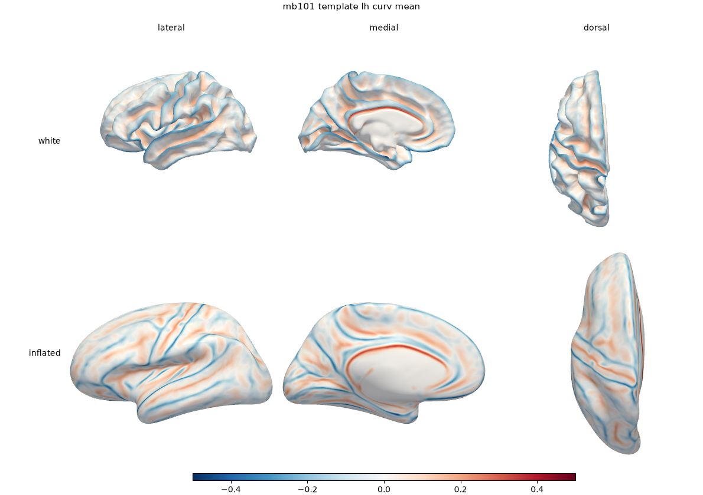
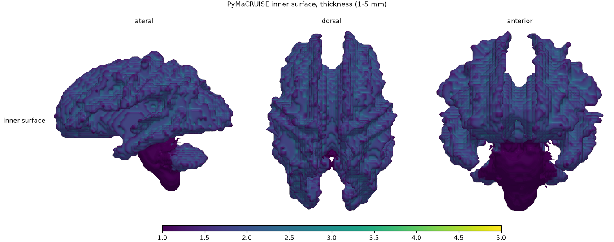
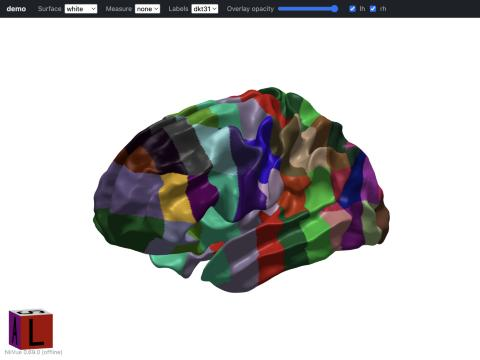

# Visualization foundation report (brief 09) — 2026-10-21

Branch `brief-09-viz` from `main` (`6f221c9`). Rows: B12.1, B12.2, B12.4, and the CLI part of B12.5.
Full suite: 408 passed, 14 skipped (`pytest -q`, macOS arm64, py3.13, `[viz]` installed, run outside the
sandbox so GL tests execute); `ruff check .` clean. Gallery images: [viz-foundation-2026-10-21/](viz-foundation-2026-10-21/),
regenerated with `python scripts/viz_gallery.py <dir>`.

## What was built

| Piece | Where |
|---|---|
| GIfTI `*.surf.gii` (Workbench `AnatomicalStructurePrimary` CortexLeft/CortexRight, `...Secondary` GrayWhite/Pial/MidThickness, `GeometricType` Anatomical/Inflated/Sphere), `*.func.gii`, `*.label.gii` with LUT label table | `pybiscuit.io.gifti` (`write_surf_gii`, `write_func_gii`, `write_label_gii`, `read_label_gii`) |
| `label.csv` + `lut.csv` → label table; deterministic HSV fallback when `lut.csv` is absent (`colors_from_fallback=True`) | `pybiscuit.io.labels` |
| TSV + JSON sidecar (BIDS-style column descriptions/units) | `pybiscuit.io.stats` |
| Camera presets (lateral, medial, dorsal, ventral, anterior, posterior; hemisphere-aware; parallel projection) | `pybiscuit.viz.cameras` |
| Fixed colour limits per measure from visualization-plan.md page 5 (mean curv ±0.05, SI ±1, thickness 1–5, sulcal depth 0–30, LGI 2–10, SCI 0–1; viridis / RdBu_r), plus template `curv/sulc/iH` display limits marked `source="pybiscuit"` | `pybiscuit.viz.colormaps` |
| Off-screen renderer (per-vertex RGB computed in Python, so VTK scalar mapping cannot change colours), label rendering with LUT, curve overlay as tubes, panel composer (N surfaces × M views → PNG with labels + colourbar) | `pybiscuit.viz.render` |
| Offline viewer: NiiVue 0.69.0 inlined, GIfTI/NIfTI embedded as base64 (opens from `file://`), or `embed=False` for relative links (needs an HTTP server) | `pybiscuit.viz.html` |
| `pybiscuit render <files> --out DIR [--views --html --parc]`, `pybiscuit view <files>` (keys `s/S` surface, `m/M` overlay, `1`–`6` presets) | `pybiscuit.viz.cli`; 8-line block in `cli.py` |

No viz import exists outside `pybiscuit.viz` (the CLI block imports `.viz.cli` only when `view`/`render` is
requested; core install and the non-viz CI job are unchanged). `pyproject.toml`: one line, package data for
`pybiscuit.viz` (`data/*.js`, `data/*.json`). The `[viz]` extra is unchanged (`pyvista`, `matplotlib`).

## NiiVue provenance

`@niivue/niivue` **0.69.0**, **BSD-2-Clause** (© 2021 Niivue; text in `LICENSES/NiiVue.txt`, row in
`docs/licensing.md`). Source `registry.npmjs.org/@niivue/niivue/-/niivue-0.69.0.tgz`, tarball SHA-256
`6e9a6a47…46af485`; bundled `dist/niivue.umd.js` SHA-256
`47b896b77ec4a5be3ef1949c33ad393b6f45629921f326c279000bcf51bdb4af` (2.3 MB). Full values in
`src/pybiscuit/viz/data/NIIVUE.json`; a test checks the file against the recorded hash. The UMD build inlines MIT
dependencies (fflate, gl-matrix, nifti-reader-js, zarrita, …). Chosen over `1.0.0-rc.*` (npm `next`) for stability.

## Acceptance

| Criterion | Result |
|---|---|
| GIfTI loads back in NiBabel with correct metadata | `tests/test_io_exports.py`: structure/secondary/geometric type per hemisphere × kind, func names, vertices/faces round trip |
| Label table matches `lut.csv` exactly | `test_label_gii_matches_lut`, both shipped protocols (`dkt31`, `braincolor`): every ID/RGB equal, names from `label.csv` |
| Opens in NiiVue | **Manual check, headless-browser automation not set up.** Template mb101 lh+rh white/inflated + curv func + dkt31 label + a synthetic NIfTI served over `http://127.0.0.1` in the in-app browser (WebKit/ANGLE-Metal): surfaces, curvature overlay with fixed limits, labels from the embedded table, hemisphere toggles and volume + surface multiplanar all rendered; no network requests other than `blob:` URLs of the embedded data. Screenshots: `niivue_curv.jpg`, `niivue_dkt31_labels.jpg`, `niivue_volume.jpg`. **Not checked:** Connectome Workbench (not installed), `file://` in Chrome/Safari/Firefox (the browser tool refused `file://`; the page has no external dependencies and uses only inline script + `Blob` URLs). |
| Snapshot tests, perceptual tolerance, skip without GL | `tests/test_viz.py`: 4 goldens at 96×96 (`tests/data/viz/`), 4×4-block mean abs diff < 0.03; skipped when `gl_available()` (subprocess probe) is false. Pure-numpy tests (cameras, limits, colours) always run |
| CI `[viz]` job on Linux | `viz` job added to `.github/workflows/ci.yml` (apt: `xvfb libgl1 libglx-mesa0 libgl1-mesa-dri libosmesa6`; `xvfb-run pytest`; `PYBISCUIT_REQUIRE_GL=1` makes a missing context a failure). **xvfb vs OSMesa: see "CI result" below.** |
| Gallery | below |
| Core install unchanged | no viz import outside `pybiscuit.viz`; `pip install -e .[dev]` suite (no pyvista) skips viz tests via `importorskip` |

### CI result

To be recorded from the PR's `viz` job (the Linux context could not be tried locally).

## Gallery

Rendered by the new code with `scripts/viz_gallery.py` (reads `reference/` and PyMaCRUISE `build/`; none of it
is committed except these PNGs).

- `template_{lh,rh}_{curv,sulc}.png` — mb101 template white + inflated, `curv`/`sulc` means, lateral/medial/dorsal, shared scale.
- `sphere_20480.png` — shipped `sphere_20480.vtk` with an analytic scalar.
- `pymacruise_inner_thickness.png` — `ace-indexed-heap-2026-10-08/.../inner_surface_thickness.vtk`, `mean_thickness_mm` on the 1–5 mm scale.
- `niivue_*.jpg` — offline viewer screenshots.

## Decisions, caveats, requests

1. **Template `curv`/`sulc`/`iH` limits** (±0.5/±1.5/±2.5) are my display convention (`source="pybiscuit"`); the original PDF shows only the quantification measures. Owner may overrule.
2. **`mean_curvature`** limits ±0.05 are applied to a measure named `mean_curvature`/`H`; the io-contract's `iH` (integrated mean curvature) is a different quantity and is not mapped onto it.
3. **Request (read-only module):** `pybiscuit.io.vtk.read_vtk` does not parse `FIELD PointData` blocks, which PyMaCRUISE's `inner_surface_thickness.vtk` uses; the gallery script reads that array itself. A reader change belongs to the owner of `io/vtk.py`.
4. **Snapshot goldens were created on macOS arm64**; Linux/Mesa output differs slightly. The tolerance is a guess until the CI job reports; widen `tol` in `tests/test_viz.py::_close` if Mesa trips it.
5. `qa/index.html` embeds data as base64: a full-resolution run (white/pial/mid/inflated/sphere × 2 hemispheres) will be tens of MB. `embed=False` writes relative links for servers (XNAT) at the cost of `file://` use.
6. Not done (out of scope per brief): PDF report (B12.3), Jupyter (`show`), curve toggle/hover read-out in `view`, cohort/parity views (B12.6). `view` has no hover read-out or colour-limit dropdown yet.
7. `view` cannot be exercised headlessly beyond `--screenshot`; interactive key handling is covered by a state-machine test only, so B12.5 stays open for the manual checklist.
