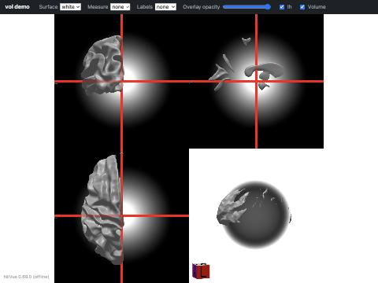
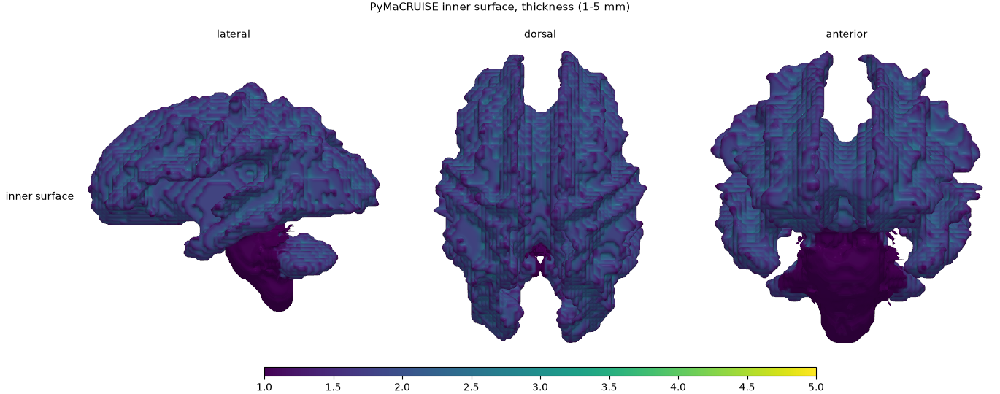
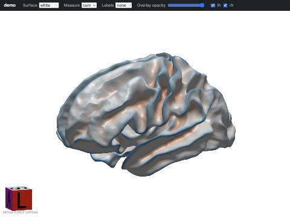
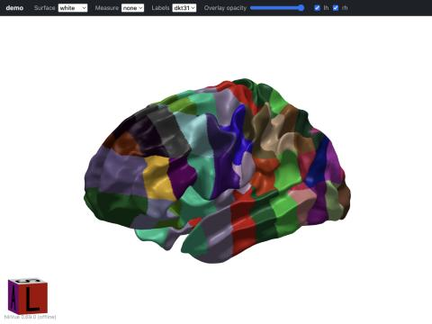
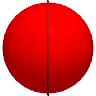
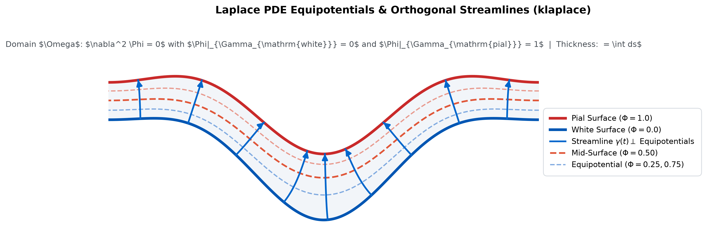
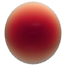
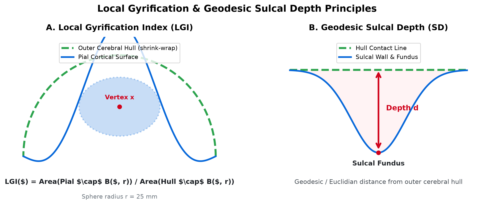

# Sample Data Walkthrough & Visualization Guide

This guide provides concrete, step-by-step instructions to run pyBiscuit, reproduce morphometry outputs, and interact with visualizations using the provided sample datasets located in `open-examples/`.

---

## 1. Obtaining the Sample Datasets (`pyBiscuit-examples`)

Sample data for pyBiscuit is hosted in the companion repository **[`pyBiscuit-examples`](https://github.com/BennettLandman/pyBiscuit-examples)**:
```
https://github.com/BennettLandman/pyBiscuit-examples
```

To download the sample data, clone the repository into `open-examples/` (or update the submodule):

```bash
# Option A: Clone directly into open-examples/ (recommended for this walkthrough)
git clone https://github.com/BennettLandman/pyBiscuit-examples.git open-examples

# Option B: Initialize git submodule
git submodule update --init --recursive tests/data/open-examples
```

The sample dataset contains three real reference subjects from the ABIDE I (NYU) cohort, processed with FreeSurfer 7.4.1 and validated against real `biscuit_FC_v2.2.sif` outputs:

```
open-examples/
├── 0050952/   # Subject 1 (Full FreeSurfer inputs + reference BISCUIT outputs)
├── 0050961/   # Subject 2
└── 0050971/   # Subject 3
```

Each subject directory contains:
- `surf/`: FreeSurfer native surfaces (`lh.white`, `lh.pial`, `lh.sphere`, `lh.inflated`) and metric files (`lh.curv`, `lh.sulc`, `lh.thickness`).
- `reg/`: Reference HSD spherical registration coefficients and registered spheres (`lh.sphere.reg.vtk`).
- `curve/`: Sulcal and gyral TRACE curves (`lh.gray.scurve.bary`, `lh.white.gcurve.bary`).
- `quant/`: Reference morphometric measures (`lh.gray.LGI.txt`, `lh.mid.SCI.txt`, `lh.gray.SD.txt`, `lh.thickness.txt`, `lh.mid.H.txt`, `lh.mid.S.txt`).
- `roi/`: DKT31 and BrainCOLOR parcellations (`lh.parc.dkt31.txt`, `lh.parc.braincolor.txt`).
- `stat/`: Template-space registered maps and summary statistics (`stats.dkt31.csv`, `stats.braincolor.csv`).
- `pdf/`: Reference QA report (`biscuit.pdf`).

### Visual Overview: Pipeline Inputs & Outputs

The table below illustrates the primary inputs and key derivatives produced by pyBiscuit on the sample data:

| Input Anatomical Volume & Surfaces | Cortical Surface Reconstruction |
|:---:|:---:|
|  |  |
| *Input T1 volume and reconstructed multiplanar views* | *Pial & white matter cortical thickness mapping* |

| 3D Interactive Curvature & Geometry | 3D Deep Parcellation (DKT31 / BrainCOLOR) |
|:---:|:---:|
|  |  |
| *Mean curvature ($H$) and shape index ($S$) on inflated cortex* | *Deep spherical U-Net parcellation with graph-cut regularization* |

| TRACE Sulcal & Gyral Curves | Morphometric Scalar Maps |
|:---:|:---:|
|  |  |
| *Extracted sulcal fundi and gyral crests over DKT31 regions* | *Surface morphometrics: thickness, LGI, SCI, sulcal depth* |

---

## 2. Step-by-Step Walkthrough

Ensure your virtual environment is active:
```bash
source <PATH>/pyBiscuit/.venv/bin/activate
export PYTHONPATH=src
```

### Step 1: Inspect Sample Inputs with `--dry-run`
Verify that pyBiscuit detects the FreeSurfer input layout, finds all required surfaces and metrics, and plans the execution stages:

```bash
pybiscuit run <PATH>/open-examples/0050952 /tmp/run_0050952 --dry-run
```


*Figure: Input T1-weighted MRI volume and reconstructed multiplanar orthogonal views in subject space.*

---

### Step 2: Run Individual Morphometric Analysis on Sample Meshes

You can execute pyBiscuit's standalone tools directly on sample surfaces:

#### A. Curvature & Shape Properties (`pybiscuit mesh-property`)
Compute mean curvature ($H$), Shape Index ($S$), and vertex areas on the mid-cortical surface:
```bash
pybiscuit mesh-property \
  <PATH>/open-examples/0050952/surf/lh.mid.vtk \
  -m -s -v \
  --surfsmoothing 2 --tensorsmoothing 2
```
*Outputs:* `<PATH>/open-examples/0050952/surf/lh.mid.H.txt`, `lh.mid.S.txt`, `lh.mid.VertArea.txt`.


*Figure: Mean curvature ($H$) mapped onto inflated cortical surface (red: sulcal fundi, blue: gyral crests).*

#### B. Sulcal & Gyral Curve Extraction (TRACE)
Extract sulcal fundic curves from the pial surface and gyral crown curves from the white surface:
```bash
# Sulcal curves on pial mesh (lh.gray.vtk)
pybiscuit trace \
  -i <PATH>/open-examples/0050952/surf/lh.gray.vtk \
  -o /tmp/lh.gray --sulcus --nhDist 20 --lsTh 0.5

# Gyral curves on white mesh (lh.white.vtk)
pybiscuit trace \
  -i <PATH>/open-examples/0050952/surf/lh.white.vtk \
  -o /tmp/lh.white --gyrus --nhDist 20 --lsTh 0.5
```
*Outputs:* `/tmp/lh.gray.scurve`, `/tmp/lh.gray.scurve.bary`, `/tmp/lh.white.gcurve`, `/tmp/lh.white.gcurve.bary`.


*Figure: Extracted TRACE sulcal fundic curves (red polylines) and gyral crests (green polylines) overlaid on cortical regions.*

#### C. Laplace PDE Streamline Thickness (`pybiscuit klaplace`)
Solve the 3D Laplace Dirichlet problem ($\nabla^2 \Phi = 0$) across gray matter to integrate orthogonal streamlines:
```bash
pybiscuit klaplace \
  --white <PATH>/open-examples/0050952/surf/lh.white.vtk \
  --pial <PATH>/open-examples/0050952/surf/lh.pial.vtk \
  --seg <PATH>/open-examples/0050952/mri/SEG_refine.nii.gz \
  -o /tmp/lh.laplace_thickness.txt
```


*Figure: Laplace PDE equipotentials ($\Phi \in [0, 1]$) and orthogonal streamline trajectories through gray matter.*


*Figure: Reconstructed continuous cortical thickness field mapped across the cortical mantle.*

#### D. Shape Complexity Index (SCI)
Calculate multi-scale Earth Mover's Distance shape complexity on the mid-cortical surface:
```bash
pybiscuit sci \
  -i <PATH>/open-examples/0050952/surf/lh.mid.vtk \
  -o /tmp/lh.mid.SCI.txt \
  -k 3.0 -s 5
```


*Figure: Shape Complexity Index (SCI) dorsal surface map showing structural folding intricacy.*

#### E. Geodesic Sulcal Depth & Local Gyrification Index (LGI)
Generate outer cerebral hull and evaluate gyrification ratios and sulcal depth:
```bash
# 1. Compute outer hull
pybiscuit outer-hull \
  <PATH>/open-examples/0050952/surf/lh.gray.vtk \
  -o /tmp/lh.hull.vtk

# 2. Geodesic sulcal depth
pybiscuit sulcal-depth \
  <PATH>/open-examples/0050952/surf/lh.gray.vtk \
  -o /tmp/lh.gray.SD.txt

# 3. Local Gyrification Index (LGI)
pybiscuit lgi \
  <PATH>/open-examples/0050952/surf/lh.gray.vtk \
  /tmp/lh.hull.vtk \
  -o /tmp/lh.gray.LGI.txt
```


*Figure: Geometric formulation of Local Gyrification Index ($\text{LGI} = A_{\text{pial}} / A_{\text{hull}}$) and Geodesic Sulcal Depth from the outer cerebral hull.*

#### F. Deep Spherical Parcellation (`pybiscuit parc`)
Regularize spherical U-Net multi-class logits with Boykov-Veksler-Zabih graph-cut $\alpha$-expansion:
```bash
pybiscuit parc graphcut \
  <PATH>/open-examples/0050952/surf/lh.sphere.vtk \
  <PATH>/open-examples/0050952/label/lh.braincolor.probabilities.npy \
  -o /tmp/lh.braincolor.annot.txt \
  --smoothness 0.25
```


*Figure: Parcellated anatomical regions (BrainCOLOR / DKT31) following spherical U-Net inference and topological graph cut.*

---

### Step 3: Interactive Visualizations

#### A. 3D WebGL Interactive Viewer (`qa/index.html`)
pyBiscuit provides a browser-based, zero-dependency 3D cortical viewer powered by bundled NiiVue:

```bash
# Open the self-contained offline viewer for subject 0050952:
open <PATH>/open-examples/0050952/qa/index_embedded.html
```


*Figure: Live offline 3D WebGL NiiVue cortical surface visualizer running directly in browser from `file://`.*

**Viewer Controls:**
- **Rotate**: Left-click + drag.
- **Zoom**: Right-click + drag or scroll wheel.
- **Pan**: Middle-click + drag.
- **Camera Views**: Click any face on the 3D orientation cube to snap to Lateral, Medial, Dorsal, Ventral, Anterior, or Posterior views.
- **Layer Switching**:
  - *Surface dropdown*: `white`, `pial`, `mid`, `inflated`.
  - *Measure dropdown*: `thickness` (1–5 mm), `sulcal_depth` (0–30 mm), `lgi` (2–10), `sci` (0–1).
  - *Labels dropdown*: `dkt31` (Mindboggle-101) or `braincolor`.
  - *Opacity slider*: Adjust transparent blend between cortical surface and overlay.

#### B. QA PDF Report (`PDF/biscuit.pdf`)
Generate the multi-page QA PDF report matching the exact page geometries (Registration, Parcellation, Curves, and Quantification):
```bash
pybiscuit report \
  -o /tmp/report_demo \
  --subject 0050952 \
  --protocols braincolor dkt31

# Open the generated report:
open /tmp/report_demo/PDF/biscuit.pdf
```


*Figure: Lateral morphometric scalar panels embedded in the multi-page QA PDF report.*

---

### Step 4: Multi-Subject Cohort Mosaic & Parity Report

Aggregate statistics across all three sample subjects, evaluate inter-subject consistency (ICC), and check parity vs reference goldens:

```bash
pybiscuit cohort \
  <PATH>/open-examples/0050952 \
  <PATH>/open-examples/0050961 \
  <PATH>/open-examples/0050971 \
  -o /tmp/cohort_report_demo \
  --protocols braincolor dkt31

# Open the interactive HTML cohort report:
open /tmp/cohort_report_demo/cohort_report.html
```

The report provides:
1. **Subject Inventory**: Validation of complete outputs for all subjects.
2. **Regional Morphometric Distributions**: Means, standard deviations, and ranges across 65 DKT31 and 111 BrainCOLOR ROIs.
3. **Outlier Flags**: Automated detection of anomalous ROI measurements based on robust $z$-scores.
4. **JSON Sidecar**: Machine-readable data exported to `/tmp/cohort_report_demo/cohort_summary.json`.

---

### Step 5: Verify Model & Template Assets

Verify that all 52 model checkpoints and templates are valid and match committed SHA-256 digests:
```bash
pybiscuit fetch-assets --verify-only
```
Or check the one-line summary:
```bash
pybiscuit info
```

---

## 3. Scientific References & PubMed Citations

The algorithms implemented in pyBiscuit are developed by Dr. Ilwoo Lyu and Dr. Bennett A. Landman and their collaborators. When publishing research utilizing pyBiscuit or its sub-components, please cite the corresponding primary literature:

### 1. Cortical Surface Registration (HSD)
- **Hierarchical Spherical Deformation (HSD)**:
  Lyu, I., Kang, H., Woodward, N. D., Styner, M. A., & Landman, B. A. (2019). *Hierarchical spherical deformation for cortical surface registration*. **Medical Image Analysis**, 57, 72–88.
  - PubMed: [https://pubmed.ncbi.nlm.nih.gov/31280090/](https://pubmed.ncbi.nlm.nih.gov/31280090/) (PMID: 31280090, PMCID: PMC6707849)
  - DOI: [10.1016/j.media.2019.06.013](https://doi.org/10.1016/j.media.2019.06.013)

- **Shape Correspondence Formulation**:
  Lyu, I., Styner, M. A., & Landman, B. A. (2018). *Hierarchical Spherical Deformation for Shape Correspondence*. **MICCAI 2018**, LNCS 11070, 866–874.
  - PubMed: [https://pubmed.ncbi.nlm.nih.gov/30680373/](https://pubmed.ncbi.nlm.nih.gov/30680373/) (PMID: 30680373, PMCID: PMC6342491)
  - DOI: [10.1007/978-3-030-00928-1_97](https://doi.org/10.1007/978-3-030-00928-1_97)

### 2. Sulcal & Gyral Curve Extraction (TRACE)
- **TRACE Algorithm**:
  Lyu, I., Kim, S. H., Woodward, N. D., Styner, M. A., & Landman, B. A. (2018). *TRACE: A Method for Robust and Consistent Sulcal and Gyral Curve Extraction on Cortical Surfaces*. **IEEE Transactions on Medical Imaging**, 37(11), 2488–2498.
  - PubMed: [https://pubmed.ncbi.nlm.nih.gov/29969416/](https://pubmed.ncbi.nlm.nih.gov/29969416/) (PMID: 29969416, PMCID: PMC6219927)
  - DOI: [10.1109/TMI.2018.2849886](https://doi.org/10.1109/TMI.2018.2849886)

### 3. Deep Spherical Parcellation & Sulcal Labeling
- **Spherical Convolutional Parcellation**:
  Lyu, I., Kang, H., Woodward, N. D., & Landman, B. A. (2019). *Cortical surface parcellation using spherical convolutional neural networks*. **Medical Image Analysis**.
  - PubMed: [https://pubmed.ncbi.nlm.nih.gov/31803864/](https://pubmed.ncbi.nlm.nih.gov/31803864/) (PMID: 31803864)

- **Context-Aware Prefrontal Sulcal Labeling**:
  Lyu, I., Bao, S., Hao, L., Yao, J., Miller, J. A., Voorhies, W., Taylor, W. D., Bunge, S. A., Weiner, K. S., & Landman, B. A. (2021). *Labeling lateral prefrontal sulci using spherical data augmentation and context-aware training*. **NeuroImage**, 229, 117758.
  - PubMed: [https://pubmed.ncbi.nlm.nih.gov/33476766/](https://pubmed.ncbi.nlm.nih.gov/33476766/) (PMID: 33476766, PMCID: PMC7954931)
  - DOI: [10.1016/j.neuroimage.2021.117758](https://doi.org/10.1016/j.neuroimage.2021.117758)

### 4. Cortical Quantification (LGI, SCI, Sulcal Depth)
- **Local Gyrification Index (LGI) & Shape Complexity Index (SCI)**:
  Lyu, I., Kim, S. H., Girault, J. B., Mostapha, M., Park, S. C., Nir, T. M., Jahanshad, N., Thompson, P. M., Piven, J., Hazlett, H. C., & Styner, M. A. (2018). *A Cortical Shape-Adaptive Approach to Local Gyrification Index*. **Medical Image Analysis**, 48, 244–258.
  - PubMed: [https://pubmed.ncbi.nlm.nih.gov/29887663/](https://pubmed.ncbi.nlm.nih.gov/29887663/) (PMID: 29887663, PMCID: PMC6132240)
  - DOI: [10.1016/j.media.2018.06.009](https://doi.org/10.1016/j.media.2018.06.009)

- **Sulcal Depth-based Shape Analysis**:
  Lyu, I., Kang, H., Woodward, N. D., & Landman, B. A. (2018). *Sulcal Depth-based Cortical Shape Analysis in Normal Healthy Control and Schizophrenia Groups*. **Proceedings of SPIE**, 10574, 105740U.
  - PubMed: [https://pubmed.ncbi.nlm.nih.gov/29725164/](https://pubmed.ncbi.nlm.nih.gov/29725164/) (PMID: 29725164, PMCID: PMC5931731)
  - DOI: [10.1117/12.2293375](https://doi.org/10.1117/12.2293375)

### 5. Cortical Reconstruction & Whole-Brain Multi-Atlas Segmentation
- **Consistent Cortical Surface Reconstruction (MaCRUISE)**:
  Huo, Y., Plassard, C. A., Carass, A., Resnick, S. M., Pham, D. L., Prince, J. L., & Landman, B. A. (2016). *Consistent cortical reconstruction and multi-atlas brain segmentation*. **NeuroImage**, 138, 197–210.
  - PubMed: [https://pubmed.ncbi.nlm.nih.gov/27184203/](https://pubmed.ncbi.nlm.nih.gov/27184203/) (PMID: 27184203, PMCID: PMC4927397)
  - DOI: [10.1016/j.neuroimage.2016.05.030](https://doi.org/10.1016/j.neuroimage.2016.05.030)

- **3D Whole Brain Deep Segmentation (SLANT / BrainCOLOR)**:
  Huo, Y., Xu, Z., Xiong, Y., Aboud, K., Parvathaneni, P., Bao, S., Bermudez, C., Resnick, S. M., Cutting, L. E., & Landman, B. A. (2019). *3D whole brain segmentation using spatially localized atlas network tiles (SLANT)*. **NeuroImage**, 194, 105–119.
  - PubMed: [https://pubmed.ncbi.nlm.nih.gov/30849524/](https://pubmed.ncbi.nlm.nih.gov/30849524/) (PMID: 30849524, PMCID: PMC6541530)
  - DOI: [10.1016/j.neuroimage.2019.03.010](https://doi.org/10.1016/j.neuroimage.2019.03.010)

- **Non-Local Statistical Label Fusion**:
  Asman, A. J., & Landman, B. A. (2013). *Non-local statistical label fusion for multi-atlas segmentation*. **Medical Image Analysis**, 17(2), 194–208.
  - PubMed: [https://pubmed.ncbi.nlm.nih.gov/23265798/](https://pubmed.ncbi.nlm.nih.gov/23265798/) (PMID: 23265798, PMCID: PMC3563914)
  - DOI: [10.1016/j.media.2012.10.002](https://doi.org/10.1016/j.media.2012.10.002)
